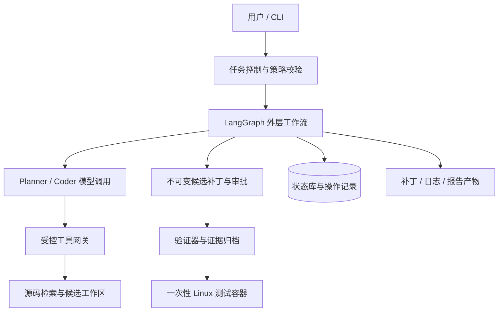
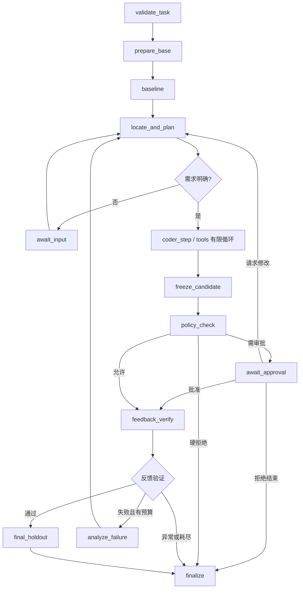

# PatchTrail 项目设计与实施方案

> 文档版本：0.1（设计基线）
>
> 编写日期：2026-10-15
>
> 文档性质：目标设计基线；当前实现状态以下方实施进展与对应实现说明为准。
>
> 项目定位：基于 LangChain / LangGraph，面向受控 Python 仓库的代码修复与独立验证 Agent。

> 2026-10-16 实施调整：按用户要求先实现本地 Web 工作台，再冻结 UI、推进后端。独立验证与初步模型工具闭环已接通；审批与执行恢复尚未实现。详见 [Web 工作台说明](WEB_WORKBENCH.md)、[验证器说明](VERIFIER.md) 和 [Agent 运行说明](AGENT_RUNTIME.md)。

## 阅读导航

实施进展（2026-10-16）：Web 布局暂时冻结。后端已实现独立人工补丁验证切片：严格 TaskSpec、固定 commit 导出、补丁范围校验、Docker pytest 基准/候选验证、确定性结论与证据归档。详见 [验证器说明](VERIFIER.md)。审批与硬退出恢复仍是后续工作；下文仍作为目标设计。

后续进展：已接入 LangChain / LangGraph 的受控工具循环与有限重试，并完成一个真实 DeepSeek 小样例，见 [Agent 运行说明](AGENT_RUNTIME.md)。审批与硬退出恢复仍未实现；原设计中的对应能力不应被当作已完成。

1. [项目定位与范围](#1-项目定位与范围)
2. [可行性与技术决策](#2-可行性与技术决策)
3. [使用场景与任务契约](#3-使用场景与任务契约)
4. [总体架构与信任边界](#4-总体架构与信任边界)
5. [LangGraph 工作流](#5-langgraph-工作流)
6. [状态与数据模型](#6-状态与数据模型)
7. [代码定位与上下文管理](#7-代码定位与上下文管理)
8. [工具与补丁协议](#8-工具与补丁协议)
9. [工作区与执行环境](#9-工作区与执行环境)
10. [独立验证与成功判定](#10-独立验证与成功判定)
11. [受控重试与预算](#11-受控重试与预算)
12. [人工审批与崩溃恢复](#12-人工审批与崩溃恢复)
13. [接口、产物与目录结构](#13-接口产物与目录结构)
14. [评估集与对照实验](#14-评估集与对照实验)
15. [测试与质量标准](#15-测试与质量标准)
16. [实施计划与验收门槛](#16-实施计划与验收门槛)
17. [风险、取舍与后续扩展](#17-风险取舍与后续扩展)
18. [设计审查清单](#18-设计审查清单)
19. [参考资料与待验证事项](#19-参考资料与待验证事项)

## 1. 项目定位与范围

### 1.1 要解决的问题

给定明确的 Bug 描述和固定版本的代码仓库，系统自动检索相关代码、提出修复假设、生成候选补丁，在隔离环境中执行测试，并在有限预算内根据失败反馈调整补丁。最终交付可以重新应用的补丁、验证结果和执行记录。

项目主要解决三个工程问题：

- 模型修改代码后，如何用模型之外的机制检验结果。
- 修复失败后，如何基于证据重试，避免无限循环和无效消耗。
- 流程被人工审批或进程退出打断后，如何恢复同一个任务及其准确产物。

第一阶段不以替代成熟 coding Agent 为目标。可比较的贡献是：在固定任务与预算下，验证、检索或恢复机制是否改善结果的可信度与可复现性。

### 1.2 第一版用户与支持条件

目标用户是维护小型 Python 项目的开发者，以及需要复现代码修复实验的研究与学习者。第一版单用户、本机执行、一次运行一个任务。

支持条件：

| 维度 | 第一版约束 |
| --- | --- |
| 仓库来源 | 用户提供的本地 Git 仓库；固定完整 commit |
| 工作树 | 输入工作树必须干净；不复制用户未提交修改 |
| 语言 | Python；其他语言作为普通文本可读，但不承诺可修复 |
| 测试框架 | pytest；显式测试入口与受控环境 |
| 项目规模 | 首轮约束为源码 1,000～20,000 行；作为筛选条件而非性能保证 |
| 依赖 | 已准备的环境配方；优先纯 Python、无需外部服务的任务 |
| 任务类型 | 明确行为错误、边界条件、跨文件数据传递错误 |
| 运行环境 | Windows 开发控制端 + Linux 容器执行；也支持 Linux 控制端 |
| 交付 | 补丁、机器可读结果、中文或英文报告、执行轨迹 |

不自动接收任意公网仓库，不在第一版运行需要生产凭证、外部数据库或 GPU 的项目。Git submodule、Git LFS、二进制补丁和符号链接修改先拒绝，避免隐含范围扩大。

### 1.3 明确不做的内容

- 通用需求开发、大规模架构重构、跨语言迁移。
- GitHub/GitLab 双平台集成、自动发布或自动合并。
- 多租户服务、分布式任务调度、强对抗不可信代码执行平台。
- 完整调用图、向量数据库、多个 Agent 并行协作。
- 以修改代码行数、节点数量或“全绿截图”作为主要成果。

PR 审查可以作为后续独立模式，其误报率和证据质量需要单独评估；不能直接用修复成功率代替审查效果。

### 1.4 交付承诺

系统可以承诺：产物绑定明确版本、状态可追踪、失败原因可区分、验收策略可审计。系统不承诺补丁一定正确，也不以测试通过证明测试覆盖之外的语义正确性。

项目成熟度按实现证据描述：设计完成、离线验证器可运行、真实模型闭环可运行、评估完成，分别报告。未经部署和验证不使用“生产级”“企业级已落地”等表述。

## 2. 可行性与技术决策

### 2.1 为什么这个范围可实现

核心循环只需要一个模型决策主体，以及可独立运行的检索、补丁和验证组件。第一版环境通过任务配置显式提供，避免先解决“任意项目自动安装”；单任务串行避免先引入队列、并发一致性和分布式锁。

最先完成验证器，即使模型尚未接入，也能用人工准备的补丁检查系统行为。这样验证正确性不依赖模型输出质量，模型成本也可延后发生。

### 2.2 技术选型

| 组件 | 初始选择 | 原因与约束 |
| --- | --- | --- |
| 控制端 | Python 3.12 作为候选基线 | 生态覆盖较稳；安装前核对所选依赖支持范围 |
| 模型与工具 | LangChain 的模型接口、工具与结构化输出 | 避免自行重复实现提供商适配；首轮只接一个通过兼容性检查的模型 |
| 外层流程 | LangGraph StateGraph | 显式状态、条件分支、检查点、中断恢复 |
| Coder | 有限步数的工具调用子循环 | 默认一个决策主体；不使用多 Agent 讨论 |
| 数据校验 | Pydantic | 校验任务配置、工具参数和产物元数据 |
| Git 操作 | 参数数组调用 Git CLI | 不插入 shell 命令字符串；集中封装错误处理 |
| 检索 | 文本检索 + Python ast | 从低复杂度工具起步；AST 关系标注不完整性 |
| 执行 | Linux Docker 容器 | 开发平台与被测平台分离；缺少环境时明确阻塞 |
| 持久化 | 本地 SQLite + 官方兼容的 SQLite checkpointer + 文件产物 | 单用户串行足够；两类存储不假设共享事务 |
| CLI | Typer 或 argparse，实施时二选一 | 先保证命令语义稳定，不为 CLI 引入过多依赖 |
| 工程质量 | pytest、Ruff，按模块逐步引入类型检查 | 检查项目自身质量；与目标仓库规则分离 |
| 依赖管理 | pyproject.toml + 一份锁文件 | 实施时锁定兼容版本，不在设计中虚构已验证版本 |

LangChain 用于模型和工具交互；LangGraph 用于外层状态控制。官方 Agent 能力见 [LangChain Agents](https://docs.langchain.com/oss/python/langchain/agents)。不同时维护两套重叠的通用重试循环：框架内部模型传输重试和项目业务重试须分开计数。

### 2.3 关键决策记录

| 决策 | 当前选择 | 暂不选择的方案与理由 |
| --- | --- | --- |
| 输入 | 本地仓库 + 显式任务配置 | 自动理解任意 issue 并配置环境的范围过大 |
| 修改方式 | 候选补丁先落产物，再按规则应用到任务副本 | 直接给模型任意 shell 和宿主写权限难以审计 |
| 验收 | 干净环境重放补丁 | 复用开发目录可能依赖残留文件或手工改动 |
| 环境 | 已构建镜像、镜像摘要、受控命令 | 自动安装未知依赖会引入执行风险与漂移 |
| 模型数量 | 一个 Coder；Planner 为结构化调用 | 多模型角色的协调收益尚无证据 |
| UI | CLI 先行 | 页面和远程审批不应先于状态语义成熟 |
| 测试修改 | 默认禁止修改既有测试及 pytest 配置；允许独立开发测试目录 | 防止通过放宽断言或改变收集规则获得表面成功 |

### 2.4 当前仓库与环境观察

本次文档编写前检查：仓库已有 README、.gitignore、空 Docs 目录，无实现代码。Git、Python、wsl 命令可在当前 PowerShell 发现；docker 命令未在当前 PATH 发现。未验证 Python 版本、WSL 发行版、Docker 服务或模型凭证。

这只表示安装和运行条件尚待核实，不表示 WSL/Docker 不存在。本文不安装软件、不修改环境、不调用付费模型。进入实施前单独给出环境检查和必要安装计划。

## 3. 使用场景与任务契约

### 3.1 代表场景

任务：优惠券订单退款错误地使用原价，应使用实际支付金额，同时保持无优惠券订单行为。

Agent 需要检索订单数据模型、优惠计算与退款函数，确认支付金额的数据来源，再形成补丁。验收器用预先确定的优惠券、无优惠券、部分退款等用例验证行为。任务只要求全额退款时，不允许模型擅自决定部分退款的新业务规则。

描述不足以确定预期行为时输出澄清请求，进入 WAITING_INPUT。CLI 允许用户补充描述后继续；评估模式则按预先定义的任务完整性规则标记，不能由评估者临时提示答案。

### 3.2 输入分为模型可见与验证器专用部分

任务契约由控制端校验，路径和命令由受信任用户或评估配置提供，不由仓库文本动态授权。

```yaml
schema_version: 1
task_id: refund-discount-001
repository:
  local_path: /input/shop
  base_commit: FULL_COMMIT_SHA
request: >-
  优惠券订单退款金额错误。修复为使用实际支付金额，
  保持无优惠券订单行为。具体部分退款规则见公开开发测试。
environment:
  image: patchtrail-fixtures/shop@sha256:ACTUAL_DIGEST
  recipe_id: shop-py312-v1
  working_dir: /workspace
  network: none
policy:
  editable_globs: ["shop/**/*.py"]
  development_test_globs: ["patchtrail_dev_tests/**/*.py"]
  protected_globs: ["tests/**", "**/conftest.py", "pyproject.toml", ".github/**"]
  max_changed_files: 5
  max_changed_lines: 250
verification:
  regression_suite_id: shop-regression-v1
  feedback_suite_id: refund-feedback-v1
  holdout_suite_id: refund-holdout-v1
  require_clean_baseline: true
budget:
  max_candidates: 3
  max_model_calls: 24
  max_tool_calls: 80
  max_active_seconds: 1200
  max_test_seconds: 120
  max_output_tokens_per_call: 4096
```

以上是配置结构示例，路径、SHA、摘要和套件 ID 都是占位值，不可直接运行。数字是初始调参值，需按试运行结果调整；配置不承诺在该预算内成功。

命令数组、验收测试内容、镜像配方等存储在控制端注册表。模型获得请求、源码、公开开发测试和允许反馈；不获得隐藏验收文件路径、完整测试内容及控制端密钥。

### 3.3 前置条件与拒绝规则

进入模型阶段之前检查：

1. 仓库可读，完整 commit 能解析为本地存在的提交，工作树无未提交改动。
2. 无未支持的 submodule、LFS 占位文件、危险路径或超出任务大小上限的输入。
3. 环境镜像可用，镜像摘要已记录，容器可创建并执行 smoke check。
4. 必需套件及可信命令配置存在，验收目标可由基准版本复现。
5. 模型配置存在，工具调用与结构化输出兼容性检查通过。
6. 产物目录可写，磁盘空间和运行锁可用。

模型未配置时，仍允许 `verify` 命令验证外部提供的补丁；`run` 则明确返回配置错误，不静默切换到规则规划器假装真实模型成功。

### 3.4 输出契约

每个任务至少产生一个 result.json，包含任务版本、最终状态、reason_code、最后尝试与选定补丁、各类验证摘要、预算消耗、产物引用及未验证内容。

终止时没有有效补丁也要有结果文件；进程硬退出时，下次启动先对账，再产生恢复记录。不能为了让报告完整而由模型编造遗漏数据。

## 4. 总体架构与信任边界



### 4.1 组件责任

| 组件 | 负责 | 不负责 |
| --- | --- | --- |
| TaskController | 配置、锁、运行生命周期、恢复入口 | 分析业务代码 |
| Graph | 状态流转和业务重试 | 直接执行任意系统命令 |
| Planner/Coder | 根据证据定位、规划、提出修改 | 裁定最终成功、批准自己 |
| ToolGateway | 参数校验、路径限制、额度和审计 | 信任模型提供的“已授权”声明 |
| WorkspaceManager | 基准快照、候选重建、内容清单 | 修改用户原始仓库 |
| PatchManager | 补丁校验、哈希、范围策略 | 自动解释并扩展业务需求 |
| Verifier | 固定套件执行、结构化结果、基线比较 | 用语言评价代替测试 |
| ApprovalService | 绑定候选、校验决定与消费记录 | 给任意后续补丁永久授权 |
| ArtifactStore | 原子落盘、内容哈希、读取限制 | 把不可信日志当成控制指令 |

### 4.2 三类信任边界

**控制端与仓库之间：** 源码、README、注释、项目内 AGENTS.md 均是待分析数据，可能包含提示注入。它们不能覆盖控制端策略、泄露凭证或授予额外工具权限。项目自己的开发约定与目标仓库内容需分开处理。

**控制端与执行容器之间：** 代码和测试会执行任意 Python 行为。只在容器内运行；不挂载 Docker socket、用户主目录、SSH 目录和模型密钥。容器返回的输出需要解析和校验。

**开发反馈与独立验收之间：** 开发目录和 Agent 可写内容不能决定测试命令、受保护套件和最终状态。

只读测试挂载只能降低篡改风险。同一 Python 进程内，恶意源码仍可能干扰 pytest 或伪造报告。因此第一版针对受控、非对抗任务，独立验证意味着独立环境与验收标准，不等于对恶意代码提供可信计算证明。

### 4.3 核心不变量

1. 用户原始仓库不被写入；所有修改发生在任务副本。
2. 每个候选补丁绑定固定基准、内容哈希与策略版本。
3. 审批对象和验收对象必须是同一候选；任何补丁变化使旧审批失效。
4. 只有确定性成功判定函数可以设置 PASSED。
5. 验收容器从干净候选重建，不能复用开发容器状态。
6. 未收集到测试、报告缺失、跳过必需测试均不能算成功。
7. 隐藏最终验收不向修复循环暴露可用于继续调参的细节。
8. 达到硬性安全边界直接拒绝，人工审批也不能解锁宿主越权操作。
9. 任意副作用均有操作标识；恢复时先对账，不假设节点只执行一次。
10. 所有结果标明验证覆盖范围及未知信息。

## 5. LangGraph 工作流

### 5.1 节点与主要路径



图中的任意执行节点都可能产生环境错误、系统错误或取消，应通过统一异常映射进入 finalize；任务运行状态不能只依赖 happy path。final_holdout 为终结性验收，不返回 Coder。

### 5.2 节点契约

| 节点 | 输入 | 输出与检查 |
| --- | --- | --- |
| validate_task | 原始配置 | 规范化 TaskSpec、策略版本、环境引用 |
| prepare_base | 仓库与 commit | 不可变基准快照、源码内容清单 |
| baseline | 基准、测试计划 | 原有回归结果、目标失败复现结果 |
| locate_and_plan | 请求、检索结果、失败摘要 | 假设、证据引用、修改范围、验证计划 |
| coder_step/tools | 当前上下文与工具响应 | 下一工具调用或提交候选；每步检查预算 |
| freeze_candidate | 当前完整修改集 | 相对基准的不可变补丁、候选树哈希 |
| policy_check | 候选元数据 | allow / require_approval / deny 与原因 |
| await_approval | 冻结候选与策略 | 绑定候选的有效人工决定 |
| feedback_verify | 同一冻结候选 | 干净重建后的反馈套件、回归结果 |
| analyze_failure | 失败分类和摘要 | 下一轮假设、继续或停止建议；最终由程序限额 |
| final_holdout | 选定候选 | 一次逻辑验收结果，独立进程或容器 |
| finalize | 所有已完成记录 | result.json、report.md 与一致的终态 |

Coder 子循环通过 LangChain 工具接口交互；可采用逐步显式调用，或封装官方 Agent。实施时只能选择一种作为控制主体。若封装 create_agent，父图仍设置外层预算，内部每次模型及工具调用由统一账本记录；不依赖框架默认无限循环。

### 5.3 规划与模型输出

Planner 输出结构化字段：

- 需求解释及无法确定的行为。
- 当前假设及代码证据：文件、符号、行号、内容哈希。
- 预计修改文件和不修改的公共接口。
- 需要执行的公开测试与回归套件 ID。
- 可能风险、缺失信息和停止条件。

只保存用户可审阅的简短理由、证据和动作，不要求或归档模型内部思维链。规划错误允许修订，但每次变更都保留版本和理由。

### 5.4 终态与等待态

状态与原因分开设计，避免把不同失败都叫“修复失败”。

| 状态 | 含义 | 典型 reason_code |
| --- | --- | --- |
| PASSED | 满足配置中的全部必需验证 | all_required_checks_passed |
| REPAIR_FAILED | 候选确实执行验证但未达到验收 | feedback_failed / holdout_failed / no_progress |
| ENVIRONMENT_ERROR | 环境阻止有效验证 | image_missing / import_setup_failed / timeout |
| CONFIG_ERROR | 输入契约不成立 | unknown_suite / invalid_revision |
| POLICY_REJECTED | 命中不可授权的禁止规则 | path_escape / forbidden_file_mode |
| BUDGET_EXHAUSTED | 调用、token、时间等达到上限 | model_calls_limit / active_time_limit |
| REJECTED | 人工拒绝并结束 | user_rejected |
| CANCELLED | 用户取消 | user_cancelled |
| SYSTEM_ERROR | 控制端或恢复一致性错误 | corrupt_artifact / invalid_transition |
| WAITING_APPROVAL | 等待人工决定，非终态 | approval_required |
| WAITING_INPUT | 等待需求补充，非终态 | ambiguous_requirement |

补丁冲突和格式错误是工具错误；在有限修正额度内反馈模型，耗尽后 REPAIR_FAILED。Python 异常应按执行上下文分类：基准依赖缺失属于环境；候选引入的语法或 import 错误属于修复失败，不能全部归为环境问题。

## 6. 状态与数据模型

### 6.1 领域对象

| 对象 | 核心内容 |
| --- | --- |
| TaskSpec | 不可变输入、版本、测试和预算配置 |
| Run | 一次运行 ID、实验配置、状态、开始与结束时间 |
| BaseSnapshot | commit、文件清单、归档哈希、环境引用 |
| Plan | 假设、证据、修改清单、版本 |
| Candidate | 序号、补丁哈希、树清单、变更统计、策略结果 |
| VerificationRun | 阶段、候选、镜像、套件、结果、日志引用 |
| Approval | 候选与策略绑定、决定、审批者、时间、消费状态 |
| Operation | 副作用 ID、输入哈希、状态、结果引用 |
| BudgetLedger | 各调用的预留、实际消耗、未知值与重试 |
| Artifact | 类型、相对路径、长度、SHA-256、创建时间 |

task_id 是业务任务标识，run_id 是单次运行标识。LangGraph thread_id 采用稳定 run_id；重新开展对照实验创建新 run，不复用旧 thread 的模型上下文。

### 6.2 图状态示意

```python
class RepairState(TypedDict):
    schema_version: int
    run_id: str
    task_spec_ref: str
    phase: str
    base_snapshot_ref: str
    current_plan_ref: str | None
    current_candidate_ref: str | None
    selected_candidate_ref: str | None
    baseline_ref: str | None
    feedback_result_ref: str | None
    holdout_result_ref: str | None
    approval_ref: str | None
    candidate_count: int
    model_call_count: int
    tool_call_count: int
    active_elapsed_seconds: float
    final_status: str | None
    reason_code: str | None
```

这是领域结构示意，省略具体导入、消息 reducer 和实现字段。大文件、完整日志与补丁不直接放入图状态；State 保存稳定引用，ArtifactStore 校验引用和内容哈希。

模型上下文独立管理：只保留当前请求、相关证据、当前完整候选、最近失败摘要与必要历史。审计日志保存全部已发生调用，不因上下文压缩被删除。摘要不能抹去预算、安全规则和已知未解决问题。

### 6.3 持久化与一致性

- 图检查点使用兼容版本的持久化 checkpointer，内存实现只用于测试。
- 应用表保存任务、候选、审批、操作和预算账本；不直接修改框架内部检查点表。
- 文件产物先写同目录临时文件，完成后原子替换，再登记哈希与路径。
- SQLite 与文件系统之间没有联合事务，LangGraph 检查点也不等于应用操作完成；依靠 operation_id、状态对账和内容寻址恢复。
- JSONL 作为可导出的事件镜像，SQLite 操作记录作为控制状态依据。崩溃留下的最后一行不完整时，忽略不完整尾行并按数据库重新导出。
- 第一版每个 run 使用单进程所有权锁；已有活跃进程持锁时拒绝重复执行。异常退出后的锁由操作系统释放，启动后检查遗留容器。

不声称 exactly-once。读取和纯计算可重放；外部执行采用“可能重复调用 + 幂等键/对账”的语义。

应用库第一轮至少维护 runs、candidates、verification_runs、approvals、operations、usage_events、artifacts 七类记录。候选哈希、操作键、审批键设置唯一约束；状态更新携带 revision 做条件写入，防止迟到结果覆盖较新状态。外键和 schema_version 在启动时检查；存在运行中旧版本任务时，不自动升级状态结构后继续执行。

## 7. 代码定位与上下文管理

### 7.1 检索分层

第一层实现目录、文件名和文本检索。优先只搜索源码清单内的 UTF-8 文本，排除 .git、.venv、构建产物、大文件和二进制文件。工具按结果数量和字节数截断，并显式返回 truncated。

第二层用 Python ast 建立函数、类、参数、import 与定义位置索引。索引键包含基准/候选树哈希，源码变化后重新索引变更文件。初期不需要数据库服务，JSON 或 SQLite 足够。

第三层提供语法级引用与有限 import 解析。结果分别标记 definition、resolved_import、syntactic_reference、unresolved_dynamic，避免把同名符号匹配当成确定调用关系。继承、别名、反射和动态导入不保证完整。

### 7.2 上下文构建策略

1. 从请求提取行为、领域名词、报错与公开测试名。
2. 检索最可能相关的函数及文件。
3. 阅读局部函数，必要时扩展类、import 和直接调用位置。
4. 同时检查对应测试以确认现有约定。
5. 获得足够证据后形成假设；信息不足则继续检索或澄清。

不把全仓库一次塞入上下文。每次读取都返回路径、行号和内容版本；修改后旧行号仅作历史引用，不能直接作为新补丁定位依据。

### 7.3 何时考虑向量检索

当固定评估显示关键词和符号检索经常找不到语义相关代码，才加入向量检索对照。需要计入索引构建成本、更新成本和额外依赖。没有评估证据前，不以 RAG 或知识图谱作为必选架构。

## 8. 工具与补丁协议

### 8.1 最小工具集

| 工具 | 参数摘要 | 返回 | 限制 |
| --- | --- | --- | --- |
| list_files | glob、limit | 相对路径与类型 | 仅输入源码清单 |
| search_code | query、path_filter、limit | 路径、行号、片段 | 默认字面量；正则需限时 |
| read_file | path、start、end | 文本与内容哈希 | 限单次大小，禁止敏感/越界路径 |
| find_symbol | name、kind | 定义与匹配置信类别 | 语法索引，不保证动态关系 |
| find_references | symbol_id | 引用位置与解析类型 | 未解析项显式标注 |
| propose_patch | expected_tree_hash、unified_diff | 候选草稿 ID 或错误 | 仅任务副本，先校验后写入 |
| run_dev_tests | registered_suite_id 或合法 node IDs | 结构化开发测试摘要 | 固定执行器，无任意命令 |
| submit_candidate | current_tree_hash、summary | 冻结候选 ID | 不等于通过，不由模型设置终态 |

不向模型暴露通用 shell、pip install、git push、宿主删除或任意网络访问。确实需要新命令时，通过受信任配置增加命令模板，而非临时让模型拼接 shell。

### 8.2 工具统一响应

```json
{
  "ok": false,
  "error_code": "STALE_TREE",
  "message": "候选内容已变化，请重新读取相关文件后提交补丁。",
  "retryable": true,
  "artifact_ref": null,
  "truncated": false
}
```

响应区分可恢复格式错误、策略拒绝、执行异常和超时；每次失败调用同样计入工具预算。模型提交参数必须经过校验，不能把字符串直接 eval 或拼接到命令。

### 8.3 补丁生命周期

1. 基于当前候选树接收增量 unified diff，检查 expected_tree_hash 防止过期写入。
2. 解析所有 old/new path、模式与操作类型，拒绝绝对路径、`..` 越界、符号链接、子模块、二进制与大小写冲突。
3. 归一化路径后再检查 editable/protected 规则。跨平台路径与重命名同时检查源和目标；MVP 不支持的操作直接拒绝。
4. 在受控临时副本执行 `git apply --check`，通过后应用；不使用 `--unsafe-paths`。该命令只检查补丁适用性，不能代替策略校验。[Git apply 文档](https://git-scm.com/docs/git-apply)
5. 与不可变基准比较，生成包含新增文件的完整累计补丁。新增文件必须显式纳入清单，不能仅依赖默认 git diff 忽略 untracked 文件。
6. 计算补丁字节哈希与候选树内容清单哈希，写入不可变 Candidate。
7. 审批、反馈验证与最终验收均引用同一 Candidate。模型继续修改时创建新候选，禁止覆盖旧候选。

第二轮可从上一轮候选重建并继续编辑，但每轮交付的都是“相对原始基准的完整补丁”。验证器始终从基准重放完整补丁，避免只应用第二轮增量造成不可复现。

### 8.4 开发测试与审批的时机

任何会执行仓库代码的开发测试都可能产生副作用，必须在容器内。普通白名单源码补丁可先在开发容器测试；需要审批的变更在审批前只允许静态检查，不执行修改后的代码。审批批准的是“该候选可以进入受控执行”，不是业务发布授权。

ToolGateway 在每次 run_dev_tests 前重新检查当前树，而不是等 submit_candidate 时才检查。命中需审批规则时先冻结当前树并进入审批节点；审批后只执行与该树哈希对应的测试。批准后模型继续编辑，又必须重新校验和必要时重新审批。

默认测试和依赖配置不在可编辑范围。需要调整其内容时，第一版可以直接声明不支持；扩展阶段允许对有限依赖/配置变更人工审批，但独立验收测试与宿主权限仍是硬禁止。

## 9. 工作区与执行环境

### 9.1 四类目录与隔离

| 区域 | 内容 | 谁能写入 |
| --- | --- | --- |
| 用户仓库 | 原始项目与 Git 元数据 | PatchTrail 不写入 |
| 基准快照 | 固定 commit 的源码与清单 | 创建后只读 |
| 候选/开发区 | 当前修改、临时开发测试 | 仅工具网关与隔离执行 |
| 验收区 | 基准重建 + 完整候选 + 可信套件 | 验证器准备；被测源码尽可能只读 |

为降低 Git hooks、过滤器与外部依赖风险，受控样例优先通过固定 commit 的源码快照重建，不把整个用户 .git 挂入容器。具体导出方式需要测试文件模式、换行与新增文件处理；忽略的必要资源通过可信任务清单显式提供。

### 9.2 容器策略

初始执行配置建议：非 root 用户、禁止 privileged、移除不需要的 capabilities、禁止提权、不挂载宿主敏感目录、禁用网络、CPU/内存/PID 限额、命令超时和有限输出。根文件系统尽可能只读，临时写入放在有限大小的 tmpfs。

内存与 CPU 需要显式限制，Docker 不会自动为每个容器设置完整资源上限。[Docker 资源约束文档](https://docs.docker.com/engine/containers/resource_constraints/)

以下为设计示意，不是已验证的跨平台启动命令：

```text
network = none
user = non-root
read_only_rootfs = true
capabilities = drop-all
no_new_privileges = true
memory = 1 GiB
cpus = 1
pids_limit = 128
tmpfs_size = 128 MiB
stdout_stderr_limit = 2 MiB each
```

每个环境配方需 smoke test：能导入目标包、正常读写允许目录、运行 pytest 并导出报告。只读源码与部分项目的运行时缓存冲突时，应改配方或声明不支持，不能静默给整台宿主开放写权限。

### 9.3 构建与执行分离

- 镜像构建/依赖下载阶段可能需要网络；只由受信任配方触发，不能由模型或目标仓库自动提供 Dockerfile。
- 镜像准备完成后记录摘要；开发、基准和验收使用同一运行环境身份。
- 验证阶段禁网，不执行动态 pip install；未满足依赖则 ENVIRONMENT_ERROR。
- 应用源码优先从指定 `/workspace` 导入，环境自检确认实际模块路径，防止误测镜像内预装的旧版本。
- 对必须构建扩展、editable install 或访问服务的项目单独适配，首批评估不纳入。

### 9.4 Windows 可行性

建议控制程序可在 Windows 运行，被测代码统一在 Linux 容器运行；任务命令使用 argv 数组，不假设 PowerShell、CMD 和 Bash 语法互通。处理盘符、反斜杠、大小写、UTF-8 与 CRLF 差异。

Linux 中的测试结果不代表 Windows 原生兼容性。报告记录执行平台。首轮镜像与文件挂载在目标机器实际验证后，才能宣称本机闭环可运行。

Docker 不可用时，可用受信任样例的本地子进程完成验证器开发，但必须显式标记为无隔离开发模式、默认关闭，且结果不计入正式容器评估。不能静默降级。

### 9.5 资源回收

每个容器带 run_id、operation_id 标签。控制端超时或取消时终止容器并等待回收，不能只结束 Docker 客户端。启动对账清理已归属本 run 的遗留执行，绝不批量删除无归属容器。

产物持久保存，临时目录按任务清单回收。删除前校验解析后的绝对路径属于运行根目录；不从模型输出生成递归删除目标。

## 10. 独立验证与成功判定

### 10.1 三类测试及其用途

| 测试类别 | 来源与权限 | 执行时机 | 是否向模型反馈 |
| --- | --- | --- | --- |
| 开发测试 | 原仓库公开测试 + Agent 新增的独立开发测试 | 定位、开发中 | 可以反馈完整受限输出 |
| 反馈验收与固定回归 | 控制端维护、Agent 不可修改 | 每个冻结候选 | 反馈允许的失败摘要 |
| 最终保留验收 | 任务作者预先确定，Agent 不可读写 | 选定候选后一次逻辑执行 | 运行结束前不返回修复循环 |

“独立”包含验收标准不受模型控制、干净环境重建、结构化证据三个方面。独立验证不必全部隐藏；反馈套件可以公开描述甚至公开用例，但模型不能修改其可信版本。

第一批任务允许只有反馈套件与固定回归，前提是报告 `holdout_available=false`。此类结果可以称“受保护测试通过”，不能声称保留集泛化效果。正式对照优先选有独立保留验收的任务。

Graph 根据 TaskSpec 决定 final_holdout 是否必需；没有登记保留套件时跳过该节点并记录 not_configured，不能记录 passed。结果增加 validation_level：feedback_only 或 feedback_and_holdout，评估汇总按层级分组，避免混合比较。

Agent 自增测试保留在单独路径，作为补丁的一部分可供审阅，但不替代固定验收标准。Agent 只能改自己创建的测试路径，不能通过新增 conftest.py、pytest 插件或 pytest.ini 改变可信套件收集行为。

### 10.2 基准验证

在修复前，对同一基准环境执行：

1. 环境 smoke check 和模块实际导入路径检查。
2. 原有固定回归测试；首轮正式任务要求基线全部通过。
3. 目标反馈测试；至少有与 Bug 对应的、稳定可复现的失败。
4. 记录收集到的测试身份、结果及工具版本。

保留验收集在制作任务时就要验证其对基准与参考修复的行为；正式运行不向模型显示该阶段详情。没有可信参考修复也可人工审核预期，但应标记证据来源。

已有失败的真实仓库暂不进入首轮主评估。后续支持时，需按 test node ID 比较基线与候选，明确允许的既有失败集合；不能只比较“失败数有没有减少”。

### 10.3 候选验收过程

1. 核对候选、审批、策略和基准版本；有任何变化即停止。
2. 从基准快照创建全新验收目录。
3. 应用该候选的完整补丁，核对目标树内容清单。
4. 注入可信测试与固定运行配置，保护其内容；不复制开发区缓存和临时文件。
5. 启动一次性容器，执行环境及模块路径自检。
6. 运行反馈验收、固定回归与必要的静态检查，各自独立记录退出码。
7. 候选通过反馈后执行最终保留验收；该候选随后不得继续修改。
8. 收集运行结果并检查日志、退出码、测试身份和报告一致性。
9. 归档所有阶段记录，由确定性判定器生成最终结论。

独立验收失败后，任务结束为 REPAIR_FAILED。用户可以新建运行继续开发，但评估中要按预先声明的协议计入，不能把多次看过保留结果的重跑包装成一次盲测。

### 10.4 pytest 结果解析

不通过搜索 stdout 中的“passed”判定成功。验证器同时收集进程退出码、容器退出信息、JUnit XML/可信适配器结果及实际测试列表。

按所锁 pytest 版本处理其公开退出码。官方文档说明了通过、测试失败、执行中断、内部错误、命令用法错误和未收集测试等状态；新增或未知退出码必须失败关闭，不能映射为通过。[pytest 退出码](https://docs.pytest.org/en/stable/reference/exit-codes.html)

必须检查：

- 必需测试确实收集并运行，测试数非零。
- 与预先审核的套件清单一致；参数化用例也需有明确身份或注册验证规则。
- 必需用例不能被 skip、xfail 或替换成空测试；任务允许的例外必须事先配置。
- 没有超时、OOM、磁盘/输出限制触发和报告截断导致的信息缺失。
- 报告格式合法、大小受限；XML 解析禁用不必要的外部实体功能。
- 报告与执行退出状态不存在明显矛盾；缺失、冲突或无法解析时不能通过。

不能仅凭测试数相同认定套件未变化。受保护文件哈希、套件 ID 和 node ID 清单都需要检查。受测代码与测试共处进程的对抗局限仍然存在，不把这些一致性检查描述为防伪证明。

### 10.5 成功判定函数

```text
passed =
    task_contract_valid
    AND baseline_eligible
    AND candidate_replays_cleanly
    AND candidate_matches_recorded_tree
    AND policy_allows_candidate
    AND required_approval_matches
    AND feedback_suite_passed
    AND required_regression_suite_passed
    AND required_static_checks_passed
    AND (holdout_not_required OR holdout_passed)
    AND evidence_complete
```

上述是项目判定逻辑，不是具体代码。预算耗尽前已经完成且产物落盘的成功验证可以归档为 PASSED；未完成所有必需步骤时，不以“应该能过”替代真实执行。

### 10.6 超时与 flaky 测试

timeout、OOM、依赖故障先记为验证不可完成，并结合基准和执行记录归因。候选引入死循环若有证据支持，reason_code 可以是 candidate_timeout，但不能假装已经确认业务断言失败。

可疑 flaky 用例在入库前多次检查，不稳定任务不纳入主要成功率。因基础设施故障而重跑时沿用同一冻结候选，设独立重跑上限并记录每次尝试；不择优挑一次通过覆盖先前失败。

## 11. 受控重试与预算

### 11.1 区分四种重试

| 类型 | 示例 | 处理 |
| --- | --- | --- |
| 传输重试 | 模型限流、短暂网络错误 | 指数退避与有限次数；计入请求记录和活跃时间 |
| 工具修正 | 过期内容哈希、补丁格式错误 | 返回结构化错误，允许少量修正；计入工具/模型额度 |
| 修复重试 | 反馈测试断言失败、候选语法错误 | 形成新假设与新候选；计入候选额度 |
| 基础设施重跑 | 容器启动故障、平台短暂不可用 | 同一候选有限重跑，不修改代码、不隐藏失败 |

框架内部重试也要纳入统计。不能外层允许 3 次、内部再无上限地重试，导致实际成本不可控。

### 11.2 失败反馈格式

```json
{
  "candidate_id": "candidate-002",
  "category": "assertion_failure",
  "suite_id": "refund-feedback-v1",
  "failed_tests": ["test_refund.py::test_discounted_order"],
  "summary": "实际退款金额仍使用订单原价。",
  "bounded_trace_ref": "artifacts/feedback-002.txt",
  "remaining_candidates": 1,
  "new_regressions": [],
  "feedback_visibility": "public-feedback"
}
```

这是示意。摘要由结构化执行证据生成或附带证据引用；模型可解释，但不改写原始结果。隐藏验收详细输出不进入该格式。

### 11.3 停止策略

- 必需验证通过：固定选定候选，进入终结流程。
- 命中硬策略拒绝：停止，不允许模型绕过。
- 候选额度、模型/工具调用或活跃时间耗尽：BUDGET_EXHAUSTED。
- 连续提交相同完整补丁且同类失败，无新增证据：有限提醒后以 no_progress 结束。
- 无法澄清预期：WAITING_INPUT，而非猜测业务规则。
- 基准阶段环境失败：不让 Coder反复修改业务代码修环境。
- 用户取消：取消未完成执行，保存已确认产物。

### 11.4 预算的具体语义

max_candidates 指冻结的不同候选数量，不是每一次工具调用；相同补丁仍消耗相应调用预算。max_active_seconds 包含模型请求、退避、工具和验证运行，不包含等待人工的时间。另设可配置等待失效时间与最长墙钟生命周期，过期审批必须重新核验对象。

每个模型请求记录模型身份、请求 ID（若提供）、输入/输出 token、耗时、重试与 usage 可用性。费用依据可追踪的价格版本计算，没有完整 usage 或价格时费用为 null，不能填零。

为避免一开始就无法完成验收，在运行 Coder 前预留一次完整验证的时间预算；不足时不发起新的模型调用。USD 成本上限仅在价格和使用量可可靠估算时提供软预警或预留，无法保证绝不超支。硬限制主要依靠调用数、输出 token 上限、输入大小和墙钟时间。

时间测量采用单调时钟计算进程内区间，持久化累计值；跨重启记录新的区间和 UTC 事件时间，不通过本地时钟相减推断准确活跃时间。

## 12. 人工审批与崩溃恢复

### 12.1 规则分为允许、需审批和硬禁止

| 级别 | 示例 | 行为 |
| --- | --- | --- |
| 允许 | 白名单源码小范围修改 | 自动进入隔离验证 |
| 需审批 | 超过建议修改规模、受支持范围内的公共接口/依赖配置变更 | 展示冻结 diff，批准后受控执行 |
| 硬禁止 | 宿主越界、隐藏测试改写、Git 凭证访问、执行特权容器 | 拒绝；人工决定也不解锁 |

“核心架构变更”不是可完全自动识别的属性。先用保护路径、导出接口变化、依赖文件、删除规模等可解释规则覆盖，再允许模型提供额外风险提示。模型提示只能提高审批级别，不能降低硬规则。

规则优先级固定为硬禁止 > 需审批 > 自动允许。TaskSpec 的 editable_globs 是能力上限，审批不扩大该范围；protected_globs 与可编辑范围重叠时取更严格策略。max_changed_files/max_changed_lines 是硬上限；另设更低的 approval_threshold 作为软阈值，只有软阈值可以通过审批继续。MVP 禁止的依赖/测试配置变更不因命中“需审批”示例而自动得到支持。

### 12.2 审批绑定

Approval 至少绑定：

```text
approval_id
run_id
base_commit
candidate_id
patch_sha256
candidate_tree_sha256
environment_identity
verification_plan_hash
policy_version
decision: approve | request_changes | reject
reviewer
created_at / decided_at / expires_at
consumed_operation_id
```

模型不能调用 approve。第一版 reviewer 为本机当前用户与日志记录，不声称企业身份认证或不可抵赖审计。未来远程 UI 必须另加认证、权限、CSRF/重放防护和审计策略。

审批前展示完整 diff、变更统计、规则命中、已有检查和接下来将执行的动作。审批后不接受外部直接修改候选目录；如变化，按哈希不一致使决定失效。

### 12.3 暂停与恢复

使用持久化 checkpointer 和固定 thread_id 调用 interrupt；收到合法决定后，通过对应恢复入口继续。LangGraph 恢复时中断节点会从头执行，因此中断前不能放置未经幂等处理的写入和外部执行。[官方中断行为](https://docs.langchain.com/oss/python/langgraph/interrupts)

建议拆分：

```text
freeze_and_store_candidate  →  prepare_approval_record
                                      ↓
                              await_approval（只读 + interrupt）
                                      ↓
                              validate_decision
                                      ↓
                              execute_candidate
```

创建审批记录使用稳定键，重复进入不能生成多个待审批对象。重复提交同一决定返回已处理结果；冲突决定、过期决定与不匹配哈希明确拒绝。

CLI 进入等待态后将检查点与产物落盘并退出，不依赖一个长期挂起的 Python 进程。approve/revise/clarify 使用短事务写入决定或补充信息；resume 再取得 run 执行锁推进图。决定保存后、恢复前再次校验 revision 与哈希。若未来支持后台常驻进程，必须沿用相同单执行者协议，不允许 CLI 与后台同时推进任务。

### 12.4 副作用操作协议

对候选构建、容器执行、报告归档等操作建立：

```text
operation_id = run_id + operation_kind + input_content_hash
PREPARED → RUNNING → SUCCEEDED | FAILED | UNKNOWN
```

执行前登记意图，成功产物落盘后登记结果。若进程在中间退出，operation 状态可能不准确；恢复时按容器标签、文件哈希与执行结果对账，不能只看状态字段。

| 中断点 | 恢复行为 |
| --- | --- |
| 候选文件已落盘，检查点未更新 | 校验哈希，补登记引用；不覆盖不可变文件 |
| 审批已保存，图尚未恢复 | 检查绑定后恢复同一 thread，不重新询问 |
| 容器仍运行，控制进程退出 | 确认归属并接管或终止，按协议决定同候选重跑 |
| 容器退出，结果未归档 | 尝试读取有限产物；证据不完整则记录未知，不推断通过 |
| 基准/镜像身份变化 | 拒绝继续，要求新建运行 |
| 检查点与应用状态冲突 | fail closed 为 SYSTEM_ERROR，保存诊断，不自动猜测跳转 |

恢复首先重建工作区，再核对图状态。检查点不能恢复已经丢失且没有快照的代码目录。物理测试执行可能重复，但同一逻辑操作不产生相互覆盖的多份权威结果。

模型请求发出前先登记预算预留。如果请求已被提供商接受但响应丢失，不能认定它免费或未执行：记录 usage_unknown，保留调用额度消耗，并在有限传输重试中使用新的操作记录。不能为追求完整响应而无限重复付费请求。

## 13. 接口、产物与目录结构

### 13.1 CLI 语义草案

以下命令用于定义产品行为，当前尚未实现：

```text
patchtrail doctor
patchtrail validate-task --task tasks/refund.yaml
patchtrail verify --task tasks/refund.yaml --patch examples/refund.patch
patchtrail run --task tasks/refund.yaml
patchtrail status --run RUN_ID
patchtrail inspect --run RUN_ID --candidate candidate-002
patchtrail approve --run RUN_ID --approval APPROVAL_ID --patch-sha SHA256
patchtrail reject --run RUN_ID --approval APPROVAL_ID --reason "原因"
patchtrail revise --run RUN_ID --approval APPROVAL_ID --feedback "修改意见"
patchtrail clarify --run RUN_ID --text "补充业务规则"
patchtrail resume --run RUN_ID
patchtrail cancel --run RUN_ID
patchtrail report --run RUN_ID
patchtrail evaluate --dataset evaluations/smoke.jsonl --config evaluations/baseline.yaml
```

doctor 区分“可找到命令”“服务可用”“能运行容器”“模型真实请求成功”；不会默认发起付费探测。真实模型 smoke check 作为显式选项，记录其费用与范围。

等待态命令返回可机器识别的独立退出码，不能与 PASSED 共用成功码。退出码完整映射在实现 CLI 时固定并测试，状态文件是详细语义来源。

### 13.2 运行产物

运行数据默认保存在版本控制之外的用户数据目录，以下用 `<run-root>` 表示；实施时在 .gitignore 显式忽略测试运行目录。

```text
<run-root>/<run-id>/
├── task.public.json
├── environment.json
├── result.json
├── report.md
├── events.jsonl
├── manifest.json
├── plans/
├── candidates/
│   └── candidate-002/
│       ├── changes.patch
│       ├── metadata.json
│       └── tree-manifest.json
├── verification/
│   ├── baseline/
│   ├── feedback-002/
│   └── holdout-002/
├── approvals/
└── diagnostics/
```

控制端私有任务配置、模型请求原文和隐藏验收日志另设访问范围，不默认随公开报告打包。日志可能包含源码、个人路径和测试数据，导出时脱敏。API key 不进入状态、命令参数、模型上下文和执行容器。

### 13.3 result.json 示例

```json
{
  "schema_version": 1,
  "run_id": "run-example-001",
  "task_id": "refund-discount-001",
  "status": "PASSED",
  "reason_code": "all_required_checks_passed",
  "base_commit": "FULL_COMMIT_SHA",
  "selected_candidate_id": "candidate-002",
  "patch_sha256": "ACTUAL_PATCH_SHA256",
  "verification": {
    "feedback": "passed",
    "regression": "passed",
    "holdout_available": true,
    "holdout": "passed",
    "validation_level": "feedback_and_holdout",
    "independent_replay": true
  },
  "usage": {
    "model_calls": 12,
    "candidate_count": 2,
    "active_seconds": 245.6,
    "waiting_seconds": 0,
    "cost_usd": null,
    "cost_status": "unknown"
  },
  "artifacts": {
    "patch": "candidates/candidate-002/changes.patch",
    "report": "report.md"
  },
  "limitations": ["仅验证登记的 Linux 环境和测试范围。"]
}
```

以上均为虚构示例，不代表实测结果。真实输出还需包含环境摘要、套件版本、每阶段证据引用、允许缺失字段与 schema 校验规则。

### 13.4 报告结构

1. 结果及验证范围。
2. 需求解释与代码证据。
3. 修改文件和关键行为变化。
4. 基准、反馈、回归和最终保留验收结果。
5. 失败与重试历史，不隐藏中间失败。
6. 审批记录及恢复事件。
7. 时间、模型使用量、费用和未知值。
8. 复现命令、环境身份和产物哈希。
9. 尚未验证的行为和需要人工审阅的内容。

事实字段由程序生成；模型可辅助润色说明，但不能改变状态、数字或证据。报告生成失败不得抹掉已有 result.json，记录单独的报告错误。

### 13.5 建议源码结构

```text
patchtrail/
├── Docs/
│   └── PROJECT_DESIGN.md
├── src/patchtrail/
│   ├── cli.py
│   ├── config.py
│   ├── domain/          # Task、Candidate、Verification 等 schema
│   ├── graph/           # 状态、节点、路由
│   ├── agents/          # 提示词、上下文、模型适配
│   ├── tools/           # 参数校验与工具网关
│   ├── code_index/      # 文本与 AST 检索
│   ├── workspace/       # Git 快照、候选与补丁
│   ├── sandbox/         # 容器生命周期和执行结果
│   ├── verification/    # 测试适配、判定器、套件注册
│   ├── persistence/     # 应用库、操作记录、产物
│   ├── approval/        # 规则与决定校验
│   └── reporting/
├── tests/
│   ├── unit/
│   ├── integration/
│   ├── recovery/
│   └── fixtures/
├── environments/        # 可信镜像配方与说明
├── evaluations/         # 清单、固定配置、评估脚本
├── examples/            # 可公开的小仓库与任务
├── pyproject.toml
├── README.md
└── .gitignore
```

这是模块边界草案，不要求第一天创建全部空目录。单个节点不直接依赖 Docker SDK 细节，通过 ExecutionBackend 接口注入，便于无模型测试和故障注入。

### 13.6 后续 Web UI

核心 CLI 稳定后可增加 FastAPI 和轻量页面，提供任务提交、阶段事件、diff、测试结果、审批、取消和报告下载。CLI 与 UI 共用同一服务层，不能各写一套状态机。

首轮不需要 Webhook。后续平台通知只提示状态并提供受认证入口，不把“收到某个 URL 请求”直接等同于用户批准。页面显示实施状态和实际证据，不在正常用户流程暴露不必要的框架内部字段。

## 14. 评估集与对照实验

### 14.1 分开衡量修复能力与系统可靠性

修复能力评估使用真实模型和固定代码任务；恢复、锁、审批和异常状态使用确定性测试与故障注入。离线脚本或 mock 模型可以验证状态流转，不能作为真实模型修复成功率。

### 14.2 任务集建设

先建立 5 个 smoke 任务用于打通，再扩展到约 20 个开发/评估任务；规模是起点而非统计充分性保证。训练式提示调优使用开发子集，最终报告保留独立任务子集，避免反复看答案后宣称泛化。

建议类别：

| 类别 | 例子 | 验证重点 |
| --- | --- | --- |
| 单文件逻辑 | 条件判断、累计值错误 | 基本工具与补丁闭环 |
| 边界条件 | 空输入、零值、边界索引 | 是否照顾邻近行为 |
| 跨文件数据传递 | 实付金额未传入退款层 | 检索与数据流定位 |
| API 兼容 | 新逻辑破坏原调用约定 | 固定回归与接口约束 |
| 受保护变更 | 触及登记的公共接口路径 | 审批及补丁绑定 |

环境损坏、取消、路径越界等是系统测试集，不混入纯修复任务成功率。若单独评估“异常任务识别”，需另报指标和分母。

每条记录包含 task_id、仓库来源和许可、固定 commit、问题描述、环境身份、公开反馈套件、保留套件、参考补丁或人工审核依据、任务类别、规模、预算、复现说明。

可从自建小项目或许可明确的真实历史修复制作任务。真实任务需排除泄露凭证、无法复现、依赖外部服务、测试不稳定和只靠换版本规避问题的案例。公开历史任务可能被模型预训练见过，报告这一局限。

### 14.3 对照实验顺序

第一轮所有方案使用相同最终独立判定器，避免某组采用自测、某组采用严格验收后直接比较。

| 实验 | 控制变量 | 目的 |
| --- | --- | --- |
| A：单候选 vs 反馈重试 | 同模型、任务、工具、提示模板、总体调用/token/时间上限 | 衡量反馈循环的收益及成本 |
| B：文本检索 vs 文本 + AST | 固定重试策略与预算 | 衡量符号索引的增益 |
| C：开发环境结果 vs 干净重放结果 | 同一候选配对比较 | 测量有多少表面通过无法重现 |
| D：审批与恢复故障注入 | 确定性候选、固定中断点 | 验证状态与授权的一致性 |

单候选组可在预算内检索与开发，但只冻结一个验收候选；重试组可将相同总预算分配给多个候选。允许修复反馈次数不同正是实验变量，仍需报告实际消耗。不能只强调成功率而忽略多花的 token 与时间。

若后续增加更大预算对照，单独标记为预算扩展实验。不要同时改变模型、检索、提示词与重试次数后，把改进归因于某个单独机制。

### 14.4 指标定义

| 指标 | 定义与注意事项 |
| --- | --- |
| 端到端成功率 | 通过全部必需验证的任务 / 全部已接纳的正式任务；运行中环境失败保留在分母 |
| 有效执行条件成功率 | 在确实完成有效验证的任务中通过的比例；与主指标并列，不能替代主指标 |
| 回归引入率 | 产生新回归的候选比例与涉及任务比例，分别报告 |
| 表面通过比例 | 开发测试通过、干净独立重放失败的候选 / 开发测试通过候选 |
| 耗时 | 活跃时间、等待时间、总墙钟时间，报告中位数及范围/分位数 |
| 使用量 | 每任务模型调用、输入/输出 token、工具调用、候选数 |
| 费用 | 每任务费用和费用缺失比例；未知值不当零处理 |
| 每成功任务成本 | 同一组全部任务已知总成本 / 成功任务数；成功数为零则无定义，成本缺失则不报告完整值 |
| 定位效果 | 在有人工标注的子集上，相关文件检索覆盖与读取量；不把参考补丁文件视为唯一正确集合 |
| 恢复正确性 | 故障注入后对象、审批、结果一致的比例及失败详情 |

任务预筛失败单列数量与原因；不得在模型失败后事后宣称任务不适合并移出分母。因评估器自身缺陷撤销任务时，保留版本变更与全部重跑说明。

### 14.5 可复现性

- 固定程序 commit、模型标识、提供商、参数、提示词版本、工具版本和任务清单。
- 记录评估日期，模型别名或服务端实现可能变化；即使 seed 相同也不保证完全确定。
- 成本允许时每个任务重复多次，展示任务级明细和波动，不只展示最优样例。
- 成本受限可以先一次试跑，结果标记为探索性；样本少时不声称统计显著优势。
- 正式统计保留首个预注册运行，崩溃恢复属于同一 run；人为重新开始属于新 run。
- 保存失败案例，按定位、补丁、回归、环境、超时和预算分类分析。

## 15. 测试与质量标准

### 15.1 重点测试对象

测试优先覆盖可能误报成功、越权或恢复错误的机制，不为每个薄封装堆叠重复测试。

| 层次 | 必测内容 |
| --- | --- |
| 单元 | schema、路径规范化、策略优先级、预算计算、状态判定、结果解析 |
| Git 集成 | 补丁适用性、新文件纳入、累计补丁重放、CRLF、Unicode、大小写冲突、原仓库不变 |
| 验证器集成 | 正确/错误补丁、未收集测试、必需用例跳过、报告缺失、导入错误、超时与 OOM |
| 安全边界 | 路径逃逸、符号链接、恶意参数、隐藏测试修改、密钥不进入容器 |
| 容器执行 | 网络限制、资源配置、超时后无遗留进程、只回收本 run 容器 |
| 图路由 | 反馈失败重试、预算耗尽、澄清、拒绝、取消和异常终态 |
| 审批恢复 | 旧补丁批准被拒、重复决定、进程退出、检查点与产物落盘顺序 |
| 模型 smoke | 工具调用成功、结构化输出可校验、补丁提交与真实验证链路 |

测试报告伪造相关测试用于验证明显不一致的拒绝能力，不能证明系统抵抗恶意 Python 运行时攻击。

### 15.2 三条必须跑通的路径

**成功路径：** 基准目标失败 → 搜索/读取 → 候选 → 干净反馈通过 → 最终保留验收通过 → 产物可重放。

**修复失败路径：** 第一个候选失败 → 有限重试 → 仍失败或耗尽 → 非 PASSED，保留所有失败证据。

**审批恢复路径：** 冻结候选 → 等待 → 退出进程 → 重启 → 审批同一哈希 → 恢复并验证；交换候选时旧批准必须失效。

### 15.3 验证命令与 CI 分层

无模型的单元和 Git 集成测试作为常规 CI；需要 Docker 的集成测试放在具备该能力的 runner；真实模型测试按显式配置执行并限制预算。缺少密钥时模型测试标记未运行，不能计作通过。

项目自己的 pytest/Ruff 检查与被修复仓库的 pytest 运行分开记录。没有 Docker 的开发环境不能把容器测试跳过后声称完整检查通过。

## 16. 实施计划与验收门槛

### 16.1 推荐里程碑

时间仅为单人业余到中等强度投入的粗估，不是交付保证。若同时学习 LangGraph、Docker 与 Git 补丁处理，应为集成调试额外留时间。优先按验收推进，范围超出时删减 UI、平台接入与高级索引。

| 阶段 | 主要交付 | 完成门槛 | 粗估 |
| --- | --- | --- | --- |
| M0：环境与任务契约 | doctor、TaskSpec、样例任务、环境配方 | 正确任务可校验，缺环境时有准确诊断 | 1～2 天 |
| M1：独立验证器 | 基准快照、人工补丁、容器、结构化结果 | 好补丁通过，坏补丁/空测试/超时不通过，原仓库不变 | 3～5 天 |
| M2：真实模型最小闭环 | 文本检索、读取、补丁工具、单候选 | 一个真实模型任务产出可重放补丁及证据；不承诺成功率 | 3～5 天 |
| M3：LangGraph 与受控重试 | 节点路由、账本、失败反馈、终态 | 有限重试、停止、环境归因与预算可测试 | 3～5 天 |
| M4：审批和恢复 | 持久化、候选绑定、操作对账 | 三条核心路径含进程重启演示通过 | 3～5 天 |
| M5：评估与文档 | 任务集、对照配置、明细与失败分析 | 可复现运行与诚实报告，费用缺失有标记 | 4～7 天 |

合计约 17～29 个有效工作日，任务集制作和陌生环境可能使时间增加。若只有四周兼职时间，建议完成 M1～M3、少量评估和一个基本审批演示，把完整恢复与 UI 顺延，而非同时实现全部功能。

### 16.2 每阶段的具体任务

**M0：先证明环境链路成立。**

- 确定 Python 与 LangChain/LangGraph/checkpointer 兼容版本并锁定。
- 检查 Docker 或替代的隔离执行条件；必要安装独立确认后执行。
- 建立无需外部服务的小型样例仓库和预先审核的测试。
- 明确 TaskSpec 与结果 schema，验证模型无配置时不会伪成功。

**M1：先不依赖模型。**

- 手工提供一份正确补丁和至少两份错误补丁。
- 实现基准导出、补丁适用性、全量重放与容器测试。
- 验证未收集测试、隐藏测试缺失、错误模块导入等情况。
- 确保 manifest、result 和报告能追溯同一候选。

**M2：只打通一个模型、一个仓库。**

- 实现最小工具集及逐步模型调用审计。
- 从真实模型产生补丁，而非固定答案或规则 fallback。
- 工具输出限制、非法路径和补丁错误都有明确行为。
- 运行一条完整链路，成功与失败均有可读结果。

**M3：给循环加边界。**

- 将阶段职责映射到图节点，记录精确终态。
- 增加反馈摘要、累计补丁与不超过预算的重试。
- 将传输重试、工具修正与业务重试分别计数。
- 加入不进展检测、取消和一次完整验收预算预留。

**M4：把暂停变成可恢复状态。**

- 持久化审批绑定、操作记录与产物哈希。
- 设计并测试崩溃窗口，而非只演示进程存活时等待输入。
- 使用相同 run/thread 恢复，并重建对应工作区。
- 证明旧批准不能用于新候选；禁止并发重复恢复。

**M5：用实验限制结论。**

- 先跑 5 个 smoke 任务，修正基础问题后冻结评估协议。
- 扩展任务集，优先比较“单候选 vs 反馈重试”。
- 有时间再比较 AST；否则作为后续扩展，不影响主闭环交付。
- 发布可分享的补丁、报告和去敏运行数据；按许可处理目标源码。

### 16.3 第一版发布标准

功能发布标准：

- 已完成 M1～M4 的核心验收，或在版本说明中明确缺少的阶段。
- 至少一个真实模型成功案例、一个真实失败案例及一个审批恢复案例可复现。
- 所有硬禁止规则和误报成功相关测试通过。
- README 标明安装、运行、支持范围、费用触发点与局限。
- 不自动提交、推送、发布 PR；这些行为另行实现与授权。

研究结论标准：完成固定任务与对照、记录真实用量、公布分母和失败原因后，才陈述改进幅度。功能能运行不等于策略优于基线，不预先承诺成功率。

### 16.4 最先实现的三个垂直切片

1. `verify`：固定仓库 + 人工正确补丁 → 干净容器测试 → result.json。
2. `run`：同一仓库 + 自然语言任务 → 模型工具调用 → 冻结补丁 → 同一验证器。
3. `resume`：冻结需审批补丁 → 进程退出 → 决定绑定 → 工作区重建 → 同一验证器。

每个切片从输入贯穿到证据输出，避免先建大量空目录和通用抽象后，迟迟无法运行一个任务。

## 17. 风险、取舍与后续扩展

### 17.1 主要风险

| 风险 | 后果 | 缓解与降级 |
| --- | --- | --- |
| 任意仓库环境难准备 | 时间消耗在依赖而非修复 | 首轮只支持预构建环境与受控任务 |
| 模型修复能力不足 | 有完整架构但成功案例少 | 先用可复现小任务；分析定位与补丁失败，不用伪结果填充 |
| 测试覆盖不足 | 测试通过但语义错误 | 人工审核用例、保留验收、结果标明范围 |
| 验收泄漏 | 重复调试变成对隐藏答案过拟合 | 最终保留结果不回流；重跑协议预先确定 |
| 容器隔离被高估 | 宿主或凭证暴露 | 限定非对抗场景、无敏感挂载，强对抗执行另选更强边界 |
| 恢复状态不一致 | 重复执行或批准错误候选 | 哈希绑定、操作对账、崩溃注入测试 |
| Windows/Linux 差异 | 命令、路径、换行异常 | argv、标准 Linux 测试环境、明确平台范围 |
| 费用与延迟 | 调试成本上升 | 离线验证器先行、真实调用限额、缓存纯检索结果 |
| 框架 API 漂移 | 版本升级后流程失效 | 锁文件、最小兼容性 smoke、受控升级 |
| 任务集太少或太简单 | 无法支撑效果结论 | 明细、任务类别与限制公开，不推断普遍优势 |
| 日志包含隐私或源码 | 导出泄露信息 | 去敏、导出白名单、许可与访问范围 |

### 17.2 后续扩展顺序

1. AST 检索：在已有文本基线下测量收益。
2. Web 工作台：查看任务、diff、测试和审批，复用 CLI 服务层。
3. GitHub 单平台：读取 PR/issue 与固定版本，生成供人工审阅的草稿 PR；先读后写，写操作明确授权。
4. PR 审查模式：独立设计审查发现的证据、严重程度、误报/漏报评估。
5. 多仓库与环境适配：基于已验证的配方插件扩展，先支持第二类真实项目。
6. 多任务并发与远程审批：引入用户身份、任务隔离、队列、限流和更强存储。
7. 更强沙盒：对不可信公网代码采用专门隔离服务或更强虚拟化，并重新做威胁建模。

不因为 LangGraph 能支持多分支就提前加入并行 Agent；先确认并行策略在质量、时间或成本上有收益。

## 18. 设计审查清单

实施中每次合并关键功能前，回答下面的问题：

- [ ] 目标仓库固定版本吗？用户工作树完全未被修改吗？
- [ ] 补丁含新增文件且能从基准完整重放吗？
- [ ] 当前报告、审批和测试引用同一补丁/候选树吗？
- [ ] 受保护测试和运行配置能被模型或候选改写吗？
- [ ] 测试未收集、跳过、报告缺失时是否明确不通过？
- [ ] 实际导入的是本次候选代码吗？
- [ ] 失败分类能区分候选问题、基准问题、环境和控制端故障吗？
- [ ] 最终保留验收是否回流到修复循环？
- [ ] 模型上下文是否包含密钥、隐藏测试或无关大日志？
- [ ] 取消和超时后容器、进程和临时资源是否有归属清单？
- [ ] 恢复是否检查实际产物和工作区，而非仅加载图状态？
- [ ] 所有重试是否计数，费用未知是否显式标注？
- [ ] 固定评估分母和失败运行是否保留，是否混入 mock 结果？
- [ ] 文档中实现状态、实测结果与未来设计是否分清？

## 19. 参考资料与待验证事项

### 19.1 官方参考

以下资料在 2026-10-15 编写时查阅，用于核对框架语义与执行边界。具体 API、依赖版本和启动参数仍需在实施环境通过 smoke test。

- [LangChain Agents](https://docs.langchain.com/oss/python/langchain/agents)：模型、工具和 Agent 交互能力。
- [LangGraph Interrupts](https://docs.langchain.com/oss/python/langgraph/interrupts)：中断、thread_id、持久化要求和节点重执行行为。
- [LangGraph Persistence](https://docs.langchain.com/oss/python/langgraph/persistence)：检查点与持久化概念。
- [Docker Engine Security](https://docs.docker.com/engine/security/)：容器执行与宿主安全边界；容器不能直接等同于强对抗沙盒。
- [Docker Resource Constraints](https://docs.docker.com/engine/containers/resource_constraints/)：资源限制需要显式配置。
- [pytest Exit Codes](https://docs.pytest.org/en/stable/reference/exit-codes.html)：不能把任意退出状态或未收集测试当成成功。
- [Git apply](https://git-scm.com/docs/git-apply)：补丁检查和应用；命令成功不代表业务修复正确。

### 19.2 实施前待验证

| 问题 | 当前默认 | 验证方式 |
| --- | --- | --- |
| 本机 Linux 容器是否可运行 | 尚未验证 | doctor + 最小容器 smoke，不根据 PATH 单独下结论 |
| Python 与框架兼容版本 | 候选 Python 3.12，框架版本待锁定 | 新环境安装解析、导入与最小图运行 |
| checkpointer 包与恢复接口 | 官方兼容实现 | 进程退出后同 thread 恢复测试 |
| 模型工具与结构化输出能力 | 首轮单模型 | 显式真实调用 smoke，记录费用 |
| 目标项目导入方式 | 显式源码路径 | 容器中打印并校验模块 __file__ |
| 只读源码是否满足样例测试 | 优先只读 | 配方级运行检查，必要时限制支持范围 |
| pytest 报告与套件身份提取 | 固定版本适配器 | 包含 skip、参数化、异常的最小样例 |
| Windows 文件导出与补丁重放 | UTF-8，明确换行策略 | Unicode、CRLF、新文件和路径测试 |
| 首批任务许可与复现条件 | 自建/许可明确任务 | 每条任务的元信息与人工审核 |
| 初始预算是否合理 | 示例数值待调参 | 5 个 smoke 任务记录真实消耗后冻结 |

### 19.3 开工时的决策原则

先让一份补丁得到可靠验证，再让模型生成补丁；先让单任务失败和恢复可解释，再扩展平台与界面。若某项功能无法在当前资源下完成，就缩小支持范围并明确标记，而不是用框架能力说明代替项目实现证据。
